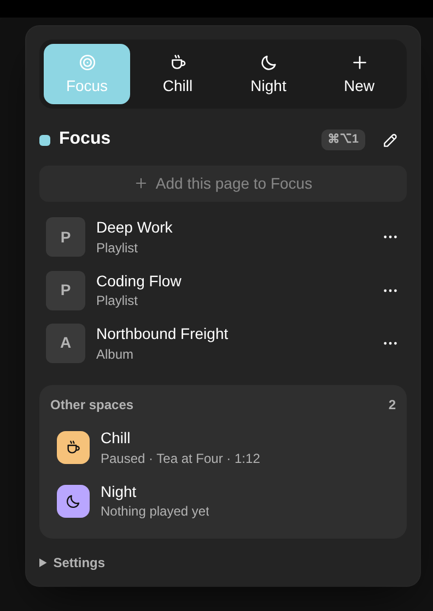

# Nordlys Spaces

Arc-style spaces for Spotify. Split Spotify into spaces, such as Focus, Chill, Gym or one per project, and each one keeps its own:

- **name, icon and color**
- **playlists, albums and artists**, shown in a list the extension draws itself
- **last open page**
- **what it was playing**: the playlist, the song and the second you left it at

Switch spaces and the music fades out, the other space picks up where you left it, and its last page opens. It works with stock Spotify and with any Marketplace theme, and it never needs a theme.



## Using it

|                                 | macOS                             | Windows / Linux                   |
| ------------------------------- | --------------------------------- | --------------------------------- |
| Open the panel                  | Spaces button in the top bar      | Spaces button in the top bar      |
| Switch to space 1–9             | ⌘⌥1 … ⌘⌥9                         | Ctrl+Alt+1 … Ctrl+Alt+9           |
| Add a playlist, album or artist | right-click it → **Add to space** | right-click it → **Add to space** |

In the panel you can switch spaces, open a space's items, add the page you're on, move or remove items (**⋯**), and create, edit or delete spaces (**New**, the pencil, or right-click a space). Deleting a space moves its items to the space next to it.

**Settings** (bottom of the panel):

- **Each space has its own music** (default): switching pauses this space and resumes the other one. A space's position is only saved if its music was actually played in that space.
- **Music keeps playing**: switching only changes the space, its items and colors.
- **Crossfade**: 0–8 seconds, default 3.
- **Tint the window**: a soft wash of the space color over the whole window. Off by default. It works without any theme.

## Install

### Spicetify Marketplace

Open **Marketplace** in Spotify, search for **Nordlys Spaces**, and click **Install**.

### Manually, on macOS or Linux

Download `nordlys-spaces.js` from the [latest release](https://github.com/juan-alvarz/SpicetiGyn/releases), then:

```bash
cp nordlys-spaces.js "$(spicetify path userdata)/Extensions/"
spicetify config extensions nordlys-spaces.js
spicetify apply
```

### Manually, on Windows (PowerShell)

```powershell
Copy-Item nordlys-spaces.js "$(spicetify path userdata)\Extensions\"
spicetify config extensions nordlys-spaces.js
spicetify apply
```

### Uninstall

```bash
spicetify config extensions nordlys-spaces.js-
spicetify apply
```

Your spaces stay saved in Spotify's local storage (`nordlys:spaces:state`) in case you reinstall.

## Good to know

- Spotify has one player, so only one space plays at a time. The others are paused snapshots, which the **Other spaces** card shows.
- Resuming lands within about a second of where you left off.
- Choosing exactly which song plays works best with Spotify Premium. Free accounts have playback limits.
- On keyboard layouts with AltGr (Norwegian, German and others), Ctrl+Alt+digit is also how you type characters like `{`. Typing in text fields is never affected.
- Up to 9 spaces, one per shortcut.

## For theme authors

Spaces publishes the current space as CSS variables (`--nl-space-accent`, `--nl-space-g1` … `--nl-space-base`) and data attributes on `<html>` (`data-nl-space`, `data-nl-space-color`, `data-nl-switching`, `data-nl-tint`). See the [styling contract](https://github.com/juan-alvarz/SpicetiGyn/blob/main/docs/styling-contract.md). The [Nordlys Spaces theme](https://github.com/juan-alvarz/SpicetiGyn/tree/main/themes/spaces-theme) uses them to paint the window in each space's colors.

## For plugin authors

Other plugins can list and switch spaces over the Nordlys event bus without importing Spaces: `spaces.list`, `spaces.current`, `spaces.switchTo(idOrName)`, and the `spaces:changed` / `spaces:updated` events. See the [architecture notes](https://github.com/juan-alvarz/SpicetiGyn/blob/main/docs/architecture.md#5-event-bus-contract).
