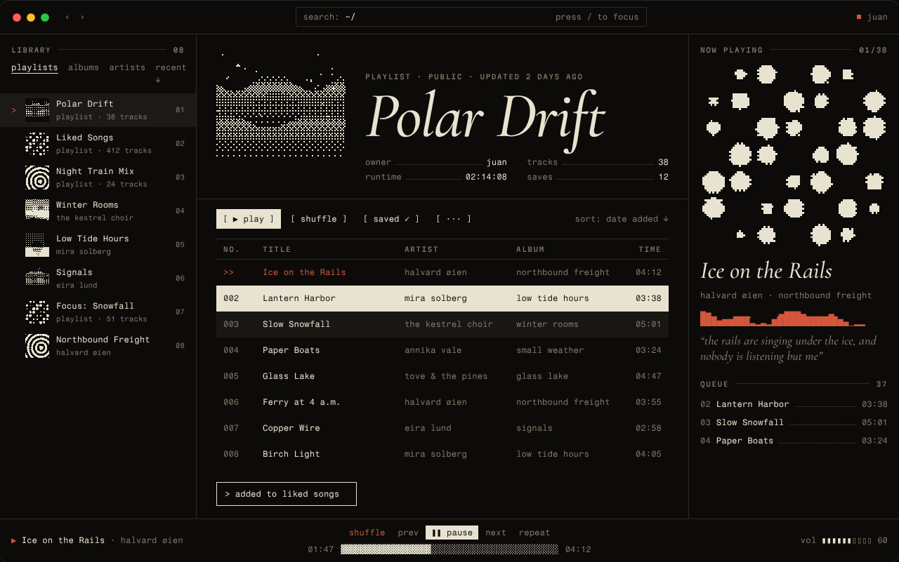

# Nordlys Codex

A terminal with a classical streak. Monospace type everywhere, a big italic serif for titles, one dark surface divided by hairlines instead of panels, square corners, and artwork reduced to grayscale.



_The preview is the design study. Inside Spotify the layout is Spotify's own; the theme changes its type, colors, lines and corners._

## Color schemes

| Scheme           | Background | Text      | Accent              |
| ---------------- | ---------- | --------- | ------------------- |
| `Bone` (default) | `#0c0b09`  | `#e8e2d0` | `#d4573b` vermilion |
| `Frost`          | `#060a0d`  | `#cde4ec` | `#7fd0ea` ice blue  |
| `Lichen`         | `#0a0c08`  | `#d9e2c4` | `#b5d67e` moss      |

## Install

### Spicetify Marketplace

Open **Marketplace** → **Themes**, search for **Nordlys Codex**, and click **Install**. Pick a scheme in the theme's settings.

### Manually, on macOS or Linux

Download `NordlysCodex.zip` from the [latest release](https://github.com/juan-alvarz/SpicetiGyn/releases), then:

```bash
unzip NordlysCodex.zip -d "$(spicetify path userdata)/Themes/"
spicetify config current_theme NordlysCodex color_scheme Bone
spicetify apply
```

### Manually, on Windows (PowerShell)

```powershell
Expand-Archive NordlysCodex.zip -DestinationPath "$(spicetify path userdata)\Themes\"
spicetify config current_theme NordlysCodex color_scheme Bone
spicetify apply
```

## Notes

- Fonts (Fragment Mono, Martian Mono, Cormorant Garamond) load from Google Fonts, so the theme looks the same on macOS and Windows. Without a connection, it falls back to Menlo/Consolas and Georgia.
- No blur and no transparency, so it renders the same on both systems.
- The design study dithers artwork into two tones. That needs an extension, so this version ships the CSS-only grayscale fallback.
- It doesn't move the top bar or touch the window drag area, so the macOS traffic lights and the Windows window buttons keep working.
