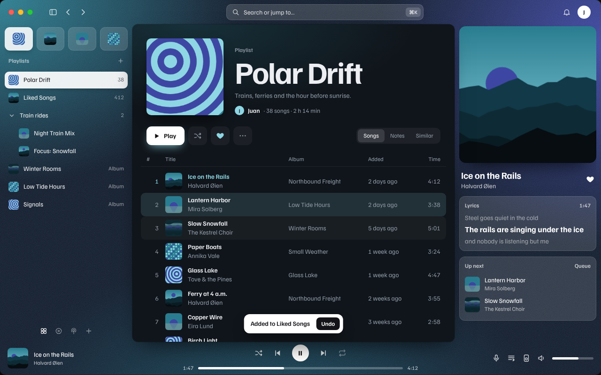

# Nordlys Spaces theme

Spotify as a browser-style workspace. The window is a grainy gradient; the library, top bar, player and right sidebar sit straight on it, and only the main view is a card floating with a soft shadow.



_The preview is the design study. Inside Spotify the layout is Spotify's own; the theme changes its colors, surfaces and type._

## With the Spaces extension

The theme works on its own. If the [Nordlys Spaces extension](https://github.com/juan-alvarz/SpicetiGyn/tree/main/plugins/spaces) is installed too, the gradient and the accent color **follow the current space** and fade between spaces when you switch. It only reads the extension's [styling contract](https://github.com/juan-alvarz/SpicetiGyn/blob/main/docs/styling-contract.md), so either one can be installed without the other.

## Color schemes

Used when the Spaces extension isn't installed.

| Scheme                | Glows               | Accent    |
| --------------------- | ------------------- | --------- |
| `FjordDusk` (default) | teal, indigo        | `#8ed6e3` |
| `Lingonberry`         | red, plum, coral    | `#f29aae` |
| `MidnightSun`         | amber, rose, violet | `#f6c27a` |

## Install

### Spicetify Marketplace

Open **Marketplace** → **Themes**, search for **Nordlys Spaces**, and click **Install**.

### Manually, on macOS or Linux

Download `NordlysSpaces.zip` from the [latest release](https://github.com/juan-alvarz/SpicetiGyn/releases), then:

```bash
unzip NordlysSpaces.zip -d "$(spicetify path userdata)/Themes/"
spicetify config current_theme NordlysSpaces color_scheme FjordDusk
spicetify apply
```

### Manually, on Windows (PowerShell)

```powershell
Expand-Archive NordlysSpaces.zip -DestinationPath "$(spicetify path userdata)\Themes\"
spicetify config current_theme NordlysSpaces color_scheme FjordDusk
spicetify apply
```

## Notes

- Familjen Grotesk loads from Google Fonts, so text looks the same on macOS and Windows.
- The grain is an inline SVG with no image files, so it stays sharp at 125% and 150% display scaling.
- It doesn't move the top bar or touch the window drag area, so the macOS traffic lights and the Windows window buttons keep working.
